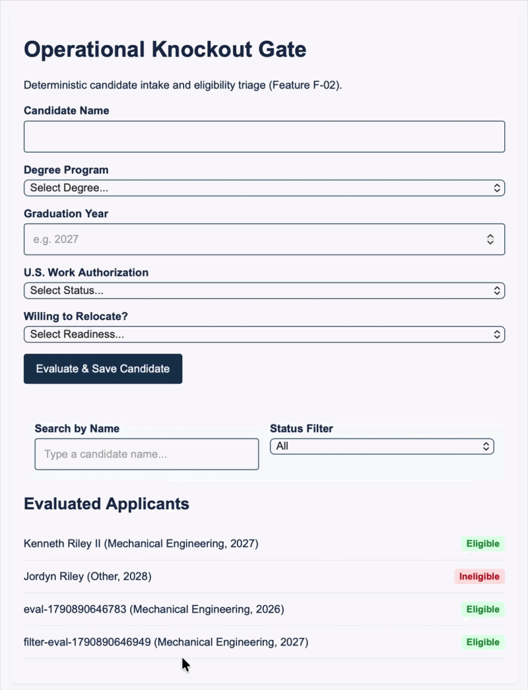
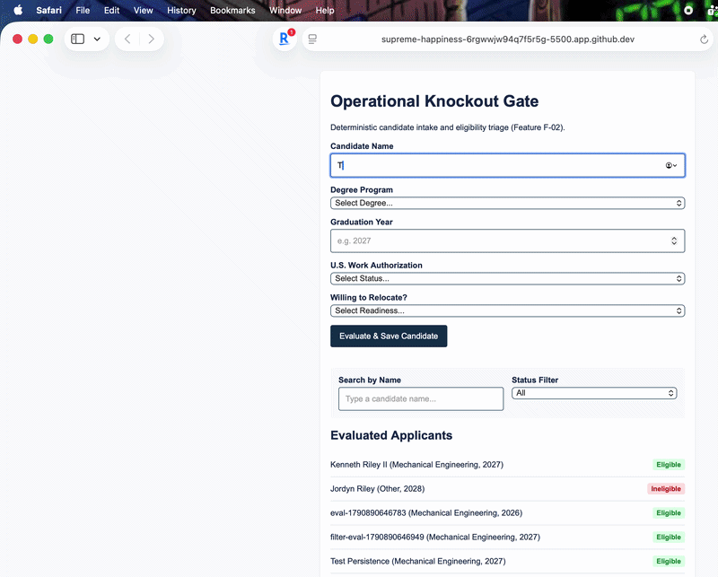
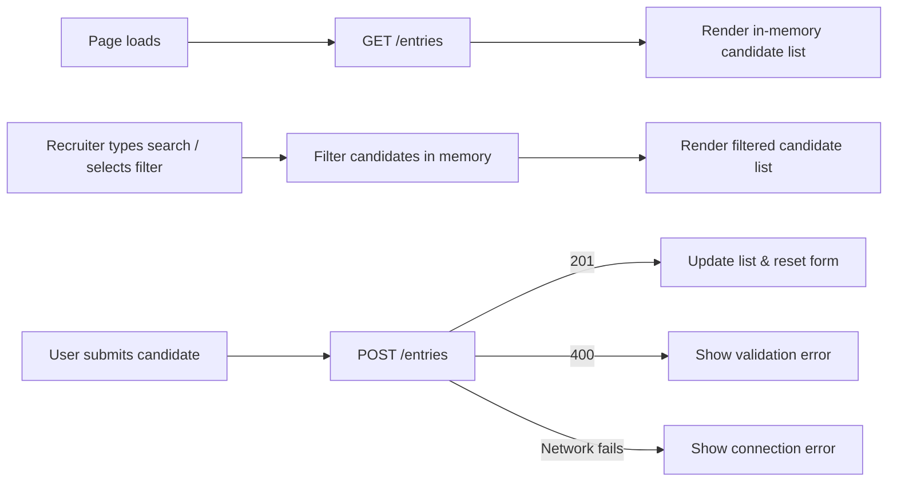

# Candidate Operational Knockout Gate

**One sentence:** A deterministic candidate screening workspace and persistent D1 audit log that helps high-volume campus recruiters verify entry-level engineering eligibility in under 5 seconds per applicant without ATS keyword-density bias.

**Deployed:** https://mgt3745-final.kdotll.workers.dev/entries
**Status:** Working — live Cloudflare Worker + D1 persistence (`mgt3745-entries`), deterministic 4-criterion knockout gate, and real-time search/status filtering are deployed and verified.  
**Hours spent:** 14

## See It Work

Candidate intake evaluation with real-time name query and status filtering:



Evidence of persistence across browser sessions and cleared cache (records reload directly from Cloudflare D1 in a fresh private browser window):





## Who It Is For

High-volume university-to-industry campus recruiters screening 500-800 engineering applications per requisition across automotive and manufacturing organizations. Existing ATS platforms rely on keyword-matching match scores that penalize authentic hands-on fabrication and co-op execution while forcing recruiters into timely manual PDF reviews. This workspace enforces four hard operational knockout rules upfront and logs every verdict in a searchable, persistent audit list.

## Run It

```bash
npm install
npm test                                               # code evals in evals/
npx wrangler dev --config worker/wrangler.toml         # only if the project has a worker/ backend
```

## The Record

| Artifact | Link |
|---|---|
| Problem and success measures | [context/PROJECT.md](context/PROJECT.md) |
| Users and jobs | [context/USERS.md](context/USERS.md) |
| Features (EARS rows) | [context/FEATURES.md](context/FEATURES.md) |
| Architecture and ADRs | [context/ARCHITECTURE.md](context/ARCHITECTURE.md), [docs/ADR-001.md](docs/ADR-001.md) |
| Sourcing audit and exit plans | [docs/SOURCING-AUDIT.md](docs/SOURCING-AUDIT.md) |
| Evals, RAT, Stakes, production verdict | [context/EVALS.md](context/EVALS.md) |
| Delegation log | [docs/DDR-LOG.md](docs/DDR-LOG.md) |
| Decision memo | [docs/DECISION-001.md](docs/DECISION-001.md) |
| Real-user feedback | [docs/FEEDBACK.md](docs/FEEDBACK.md) |
| Scaffold audits | [docs/AUDIT.md](docs/AUDIT.md) |
| Deployment notes | [docs/DEPLOY.md](docs/DEPLOY.md) |
| Self-review with Homogenization Check | [docs/SELF-REVIEW.md](docs/SELF-REVIEW.md) |

## AI Use

Bolt.new was delegated to scaffold the initial static HTML/CSS layout structure during early prototyping, while Gemini assisted with specification alignment, test authoring, and sourcing audit verification, with every delegation task logged in a pre-tool `DDR` entry in `docs/DDR-LOG.md` before generation. To maintain independent verification, no AI assistant acts as the sole grader for features it helped write, and any evaluation of my Riskiest Assumption (`RAT`) or production verdict is conducted strictly against raw user observation notes and unedited D1/test outputs rather than author summaries.